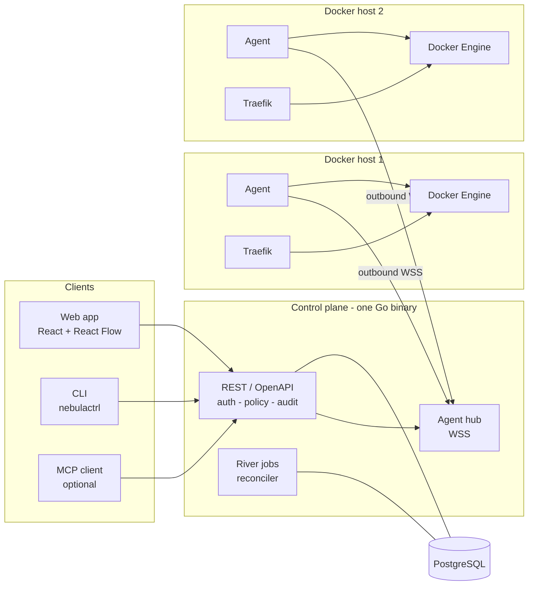

# NebulaCtrl

[](https://scorecard.dev/viewer/?uri=github.com/nebulactrl/nebulactrl)

**Railway's developer experience for infrastructure you own.**

NebulaCtrl is a self-hosted, Docker-native platform-as-a-service. Connect your own Linux servers (a VPS, a homelab box), arrange services on a canvas, deploy from a Git repository or a container image, attach domains with automatic HTTPS, and manage variables, logs and rollbacks from one place. The same operations are available through a REST/OpenAPI API, a CLI and an optional MCP server.

It is free to use. The installer (`curl -fsSL https://nebulactrl.com/install.sh | sudo bash`) and the container images (`ghcr.io/nebulactrl/nebulactrl`, public) need no account. The CLI is served by your own control plane (`curl -fsSL https://<your control plane>/cli.sh | sh`).

- Docker Engine is the only runtime. No Kubernetes, no Swarm.
- Multi-server: each server runs a small Go agent that dials *out* to the control plane, so homelab hosts behind NAT work.
- Fleet overview and server drain: see per-server memory limits against host capacity, and evacuate a server one service at a time before maintenance or retirement ([`docs/operations/draining-servers.md`](docs/operations/draining-servers.md)). Volumes are not copied.
- No mandatory AI, no cloud account, no telemetry. MCP is off by default.
- Honest deployment semantics: health checks, rolling vs recreate, and rollback of application image and configuration only (never data).
- Teams with roles and invites, SSO (OIDC, GitHub), passkeys and TOTP two-factor sign-in, an audit log, and scoped API tokens.
- Git providers (GitHub App, GitLab, Gitea/Forgejo, Bitbucket) with push auto-deploy, watch paths and PR preview environments; cron tasks and one-off commands; notifications by email, Slack, Discord, Telegram and signed webhook.
- 350 reviewed one-click templates (with update diffs) and managed databases (PostgreSQL, MySQL, MariaDB, Valkey, Redis, MongoDB, ClickHouse) with scheduled backups and restore.
- A web terminal and container file browser, TCP/UDP routes, DNS-01 wildcard certificates, per-service Tailscale, replicas with autoscaling, and traffic analytics with a request-origins map.

> **Status: pre-release, under construction.** NebulaCtrl is free, self-hosted and open source. **License: [AGPL-3.0-only](LICENSE)** ([ADR 0005](docs/decisions/0005-license.md)).

## Architecture



Decisions behind this picture: [Go modular monolith](docs/decisions/0001-go-modular-monolith.md), [agent transport](docs/decisions/0002-agent-transport.md), [Traefik proxy](docs/decisions/0003-traefik-proxy.md), [builds on the target host](docs/decisions/0004-build-on-target-host.md).

## Quickstart (development)

Prerequisites: Go 1.27, [bun](https://bun.sh) 1.4, Docker 29 (with Compose), [sqlc](https://sqlc.dev) 1.30, `openssl`.

```sh
make setup      # checks tools, creates .env with a fresh NEBULACTRL_SECRET_KEY, bun install
make dev        # starts Postgres, the control plane on :8080 and the web app on :5173
```

Open <http://localhost:5173>, create the admin account on the setup page, then enroll the local Docker daemon as a server:

1. In the UI open **Servers → Add server** and copy the enrollment token (single use, valid for 1 hour).
2. In a second terminal: `make dev-agent TOKEN=<token>`. This builds the agent image, creates the `nebulactrl-edge` Docker network if missing and starts `agent1`, which starts its own Traefik proxy (HTTP on host port 8880, HTTPS on 8443).
3. The server appears as **online** with its facts. Create a project, add an image service such as `traefik/whoami` on port 80 with the domain `whoami.localhost`, deploy, then:

   ```sh
   curl -sk --resolve whoami.localhost:8443:127.0.0.1 https://whoami.localhost:8443/
   ```

Other targets (`make help` lists them all):

| Target | What it does |
|---|---|
| `make dev-deps` | start only Postgres |
| `make dev-down` / `make dev-reset` | stop dev containers / also delete their volumes |
| `make generate` | regenerate sqlc, `openapi/openapi.json`, and the web and Go API clients |
| `make test` | tier 1: Go and web unit tests |
| `make test-smoke` / `make test-full` | tier 2 / tier 3: Docker-backed integration tests (core scenarios / everything) |
| `make lint` | `go vet` and biome |
| `make build` | web build, then `bin/nebulactrl-server` (web embedded), `bin/nebulactrl-agent`, `bin/nebulactrl` |
| `make build-agents` | static Linux agents for amd64 and arm64 in `bin/agents` |
| `make e2e` | Playwright smoke test |

A second, independent Docker host for multi-server testing is available with the `multi` compose profile; see [`deploy/dev/docker-compose.yml`](deploy/dev/docker-compose.yml).

## Known limitations

- A Compose file runs as one [stack](docs/operations/compose-stacks.md) with limits (recreate only, no `build:`, no replicas) or can be [imported once](docs/operations/compose-import.md) into staged services; other sources are Git (Dockerfile, or Railpack when there is none), images and one-click templates, plus [managed databases](docs/operations/databases.md) (PostgreSQL, MySQL, MariaDB, Valkey, Redis, MongoDB, ClickHouse) that are ordinary image services with generated credentials, derived `DATABASE_URL` exports, credential rotation and version upgrades. See [`docs/operations/limitations.md`](docs/operations/limitations.md) for the full list of gaps.
- Cross-server networking is the opt-in [mesh](docs/operations/mesh.md) (tagged tailnet devices; TCP only, same environment only); without it each host has its own Docker networks and proxy and cross-host dependencies need a user-provided route (VPN, tunnel, public domain). PostgreSQL can have manual [read replicas](docs/operations/database-replicas.md) with a manual Promote; there is no automatic switching.
- Zero-downtime (rolling) only for services with an HTTP port and no volumes. Everything else is stop-then-start.
- Rollback restores application image and configuration, never databases, volumes or external services.
- Docker access is root-equivalent and the security boundary is a trusted team ([`SECURITY.md`](SECURITY.md)).
- Dark theme only. Single control-plane instance. Linux hosts only for agents.

## License

NebulaCtrl is free to use, self-hosted and open source. The source is on [GitHub](https://github.com/nebulactrl/nebulactrl) under the [GNU Affero General Public License v3.0 only](LICENSE) (`AGPL-3.0-only`), see [ADR 0005](docs/decisions/0005-license.md). Third-party notices are in [`NOTICE`](NOTICE) and the dependency scan is in [`docs/security/third-party-licences.md`](docs/security/third-party-licences.md).

## Documentation

[`docs/`](docs/README.md) · [`CONTRIBUTING.md`](CONTRIBUTING.md) · [`SECURITY.md`](SECURITY.md)
